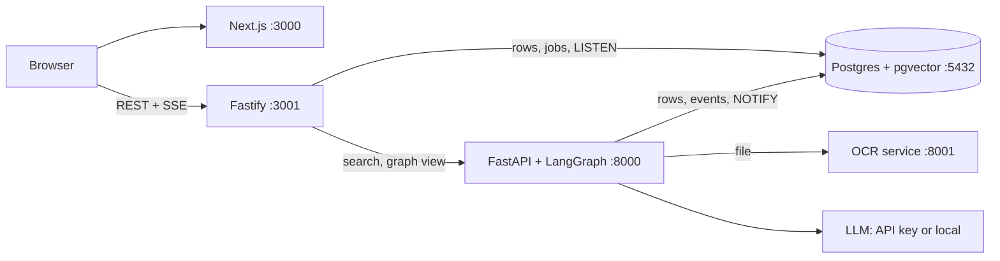

# TaskMaster

TaskMaster is a single-user AI coworker that runs entirely on one Windows laptop. You create a workspace and add documents in most office formats. You then chat with an agent that searches them, follows the relationships between the people, projects and organizations they mention, drafts artifacts, and asks before it writes any file.

> **Status: being built. Steps S01 to S07 of 25 are done.** The architecture is final and the build plan is written. Only the machine setup, `yarn doctor`, `yarn check:arch`, the database scripts, `yarn dev`, the bare web, agent and OCR services (a health check and the security checks, and in the web app a placeholder home page), and the API's workspace and thread routes work so far; anything else in this README is marked *(planned, S<NN>)* with the step that builds it. To see how far the build has got, run:
>
> ```text
> git grep -n "^status:" -- docs/build/steps
> ```

## Contents

- [What it does](#what-it-does)
- [How it works](#how-it-works)
- [Design principles](#design-principles)
- [Repository layout](#repository-layout)
- [Requirements](#requirements)
- [Setup](#setup)
- [Everyday commands](#everyday-commands)
- [Configuration](#configuration)
- [Choosing a model](#choosing-a-model)
- [Testing and evals](#testing-and-evals)
- [Security and privacy](#security-and-privacy)
- [Performance and memory](#performance-and-memory)
- [How it is being built](#how-it-is-being-built)
- [Changing the design](#changing-the-design)
- [Not in v0](#not-in-v0)
- [Documentation](#documentation)

## What it does

- **Workspaces** keep each project's documents, chats, knowledge graph and artifacts separate.
- **Documents**: TXT, MD, PDF, DOC, DOCX, XLS, XLSX, PPT, PPTX, PNG, JPG and TIFF, up to 25 MB and 200 pages each.
  - Plain text and Markdown are read directly. Everything else goes through local OCR, including PDFs that already contain text, and spreadsheets.
- **Search**: each document is split into chunks and embedded locally, so the agent finds passages by meaning and cites the file and page.
- **Knowledge graph**: when a document is added, the model extracts the entities it mentions (people, organizations, projects and more) and the relations between them. The agent can follow these up to 2 hops, across documents.
- **Chat**: answers stream as they are written. A run keeps going if you close the tab, and picks up where it left off when you come back.
- **Artifacts**: the agent saves drafts inside TaskMaster, which you can rename, read and download.
- **Approvals**: writing a file to disk always waits for you to approve or reject it. A pending approval survives a restart and expires after 24 hours.
- **Evals**: a fixed test suite scores OCR, retrieval, graph extraction, agent behavior and answer quality, so you can compare models on an `/evals` page.

## How it works



| Part | Technology | Job |
| --- | --- | --- |
| `apps/web` | Next.js 16, React 19 | The interface: workspaces, documents, chat, approvals, artifacts and eval results. No business logic. |
| `apps/api` | Fastify 5, Node 26 LTS | The browser's only backend: CRUD, uploads, job submission and live events |
| `services/agent` | FastAPI, LangGraph 1.2, Python 3.14 | The agent graph and its tools, document ingestion, entity extraction and retrieval |
| `services/ocr` | FastAPI, LibreOffice 26.8, RapidOCR 3.10 | Turns documents into page images, then text. Stateless. |
| Postgres | Postgres 19, pgvector 0.8.7 | Stores everything: records, the job queue, live run events, vectors, the knowledge graph, agent checkpoints and eval results |

**Postgres is the only data store.** There is no Redis, no Neo4j and no separate vector database:

- **Jobs** are rows that the agent claims with `SELECT ... FOR UPDATE SKIP LOCKED`.
- **Live events** are rows, announced with `LISTEN`/`NOTIFY`.
- **The knowledge graph** is a pair of `entities` and `relations` tables, walked with a recursive SQL query.

**Adding a document:**

1. Fastify saves the file and queues an `ingest` job.
2. The agent sends it to the OCR service, unless it is `.txt` or `.md`.
3. The agent saves the pages, splits them into chunks, and embeds them locally with `bge-small-en-v1.5`.
4. The model extracts entities and relations from the chunks.
5. The document becomes `ready`.

**Sending a message:**

1. Fastify records a run and queues it.
2. The agent runs the LangGraph graph: call the model, pause for approval if any tool needs it, run the tools, and repeat. It writes events to Postgres as it goes.
3. Fastify streams those events to the browser over SSE.
4. Each thread has at most one active run. A run stops after 15 model calls or 10 minutes of running.

| Agent tool | Does | Needs approval |
| --- | --- | --- |
| `search_documents` | Vector search, top 5 chunks with page numbers | No |
| `query_graph` | Relations within 2 hops of an entity, with their source text | No |
| `read_document` | One document's text, by page range | No |
| `save_artifact` | Saves a draft inside TaskMaster | No |
| `write_file` | Writes a file inside one configured folder | **Yes** |

## Design principles

- **Local first.** Everything runs natively on Windows, with no Docker. OCR and embeddings never leave the laptop.
- **One database.** Postgres holds all state, so there is one thing to back up and one transaction boundary.
- **The model is never trusted with side effects.** The approval check is code, not a prompt. Document text is treated as data, the model never writes queries, and tools with side effects are safe to run twice.
- **Deterministic where it can be.** Every model call uses `temperature=0` and `seed=7`. Tests use a scripted stub model, and lists have stable ordering. Parallel OCR produces exactly the same text as single-process OCR.
- **Measured, not assumed.** Version choices, OCR speed and memory use were checked on the target laptop. The [architecture](docs/architecture.md#what-was-tested) lists what was tested and what wasn't.

## Repository layout

What exists today:

```text
AGENTS.md                      how coding agents work through the build steps
CLAUDE.md                      imports AGENTS.md for Claude Code
package.json, yarn.lock        the Yarn workspace root and its commands
.env.example                   every setting, with placeholder values
tsconfig.base.json             shared TypeScript settings
pyrightconfig.json             lets the editor resolve each service's venv
scripts/doctor.mjs             yarn doctor: checks the installation
scripts/py.mjs                 runs a service's Python from the repository root
scripts/check-architecture.mjs yarn check:arch, with its tests beside it
scripts/db.mjs                 yarn db:migrate and yarn db:reset, with its tests beside it
scripts/dev.mjs                yarn dev: starts web, API, agent and OCR together
scripts/health.mjs             waits until all four services answer
db/schema.sql                  the whole Postgres schema
apps/web/                      the Next.js app so far: a placeholder home page, the CSP and Host check, the API client, a smoke test
apps/api/                      the Fastify API so far: health check, security checks, workspaces and threads
services/agent/                the agent service so far: health check and security checks
services/ocr/                  the OCR service so far: health check and security checks
docs/architecture.md           the final design
docs/build/README.md           build rules, step index, implementation choices
docs/build/contracts.md        ports, environment, APIs, payloads, events
docs/build/steps/              S01 to S25, one file per step, each with a status
docs/build/progress.md         what each finished step built
docs/build/allowed-dependencies.json   every dependency the code may declare
```

What the build steps add:

```text
services/agent/      the LangGraph agent, ingestion and retrieval, on top of the skeleton
services/ocr/        LibreOffice + RapidOCR extraction, on top of the skeleton
evals/               eval documents, cases and runner
```

## Requirements

TaskMaster targets one Windows 11 laptop. Minimum versions:

| Software | Version | Notes |
| --- | --- | --- |
| Windows | 11 | LibreOffice 26.8 needs Windows 10 or newer |
| Node | 26.13.1 LTS | |
| Yarn | 4.19.0 | Through corepack |
| Python | 3.14.10 | **Not 3.15:** onnxruntime has no Python 3.15 wheels yet |
| Postgres | 19.0 | EDB installer, until winget offers it |
| pgvector | 0.8.7 | Built from source with the Visual Studio 2026 C++ tools |
| LibreOffice | 26.8.3 | |
| Ollama | 0.40.19 | Optional, only for a local model |

Plan on 2.5 to 4 GB of free memory while a document is being OCR'd, plus the model's own needs if it runs locally. See [Performance and memory](#performance-and-memory).

## Setup

> These steps describe the finished project. Today, steps 1 to 4 and 6 work, and in step 5 only `yarn doctor` and `yarn db:reset` do. Each later command is marked with the step that builds it.

**1. Install the services.** Most need administrator rights. Full instructions are in [S01](docs/build/steps/S01-machine-setup.md) and in the architecture's [Installing the services](docs/architecture.md#installing-the-services).

```text
winget install -e --id Python.Python.3.14
winget install -e --id TheDocumentFoundation.LibreOffice
winget install -e --id Ollama.Ollama          # optional
```

Then:

1. Install Postgres 19 with the EDB installer.
2. Build pgvector 0.8.7 from source.
3. Limit Postgres to `localhost` with password logins.
4. Create the `taskmaster` role.
5. Create the folders `C:\taskmaster-data\uploads`, `C:\taskmaster-data\out` and `C:\taskmaster-data\models`.

**2. Keep the repository out of OneDrive.**

**3. Configure.**

```text
copy .env.example .env
node -e "console.log(require('crypto').randomBytes(32).toString('hex'))"
```

Fill in `.env`. Put the generated value in `INTERNAL_TOKEN`, and add your database passwords and model settings.

**4. Install the dependencies** from the committed lockfiles. The `-dev` files add pytest and ruff, which `yarn test` needs:

```text
yarn install --immutable
py -3.14 -m venv services\agent\.venv
services\agent\.venv\Scripts\pip install --require-hashes -r services\agent\requirements.txt -r services\agent\requirements-dev.txt
py -3.14 -m venv services\ocr\.venv
services\ocr\.venv\Scripts\pip install --require-hashes -r services\ocr\requirements.txt -r services\ocr\requirements-dev.txt
```

**5. Check, create the databases, and download the local models.** `yarn doctor` and `yarn db:reset` work today, and the two warm-ups are *(planned, S09 for OCR and S12 for the agent)*:

```text
yarn doctor
yarn db:reset --all
node scripts/py.mjs agent -m app.warmup
node scripts/py.mjs ocr -m app.warmup
```

**6. Run it**, then open <http://localhost:3000>. Use `localhost`, not `127.0.0.1`: the API only accepts requests from that origin.

```text
yarn dev
```

## Everyday commands

| Command | Does |
| --- | --- |
| `yarn doctor` | Checks every installation, version and setting, and prints what is missing. `--strict` also requires the model endpoint to answer. |
| `yarn check:arch` | Checks that the code still matches the architecture |
| `yarn dev` | Starts web, API, agent and OCR together. Stopping it, or a crash of any one of them, stops all four. |
| `node scripts/health.mjs` | Waits up to 60 seconds for all four services to answer, while `yarn dev` runs in another terminal. Exits 0 when they do. |
| `yarn db:migrate` | Applies `db/schema.sql` to an empty database |
| `yarn db:reset [--main\|--test\|--eval\|--all]` | Drops and recreates databases. **Deletes their data.** |
| `yarn test` | Runs every workspace's tests (today the API, agent and OCR services) |
| `yarn typecheck` | Type-checks the TypeScript workspaces (web and API) |
| `yarn e2e` | Runs the Playwright end-to-end tests. It starts its own `yarn dev --e2e` (stop any other `yarn dev` first). Run `yarn workspace @taskmaster/web playwright install chromium` once beforehand. Today it runs three smoke tests; the stub model arrives in S13. |
| `yarn evals [--stub] [--layer <name>]` *(planned, S23)* | Runs the eval suite and stores the scores. Needs the OCR service running. |

v0 has no incremental migrations: the schema is applied whole, so `db:reset` is how the schema changes during the build.

## Configuration

All settings live in `.env` at the repository root, which is never committed. `.env.example` lists every variable, and [contracts.md](docs/build/contracts.md#ports-and-environment) describes each one with its default. The main groups:

| Group | Variables |
| --- | --- |
| Databases | `DATABASE_URL`, `TEST_DATABASE_URL`, `EVAL_DATABASE_URL`, `PG_ADMIN_URL` |
| Folders | `UPLOAD_DIR`, `WRITE_DIR` (the only folder `write_file` can write to), `MODEL_CACHE_DIR` |
| Services | `INTERNAL_TOKEN`, `AGENT_URL`, `OCR_URL`, `SOFFICE_PATH` |
| Model | `LLM_BASE_URL`, `LLM_API_KEY`, `LLM_MODEL`, and optionally `JUDGE_*` for eval judging |
| Limits | `RUN_LLM_CALL_LIMIT` (15), `RUN_TIME_LIMIT_SECONDS` (600), `APPROVAL_TIMEOUT_SECONDS` (86400) |
| Jobs and events | `JOB_POLL_SECONDS`, `JOB_LOCK_SECONDS`, `JOB_HEARTBEAT_SECONDS`, `JOB_MAX_ATTEMPTS`, `RUN_EVENTS_TTL_SECONDS` |
| OCR | `OCR_WORKERS` (2), `OCR_THREADS_PER_WORKER` (4), `OCR_TIMEOUT_SECONDS` (120) |

| Service | Port, bound to `127.0.0.1` |
| --- | --- |
| Web | 3000 |
| API | 3001 |
| Agent | 8000 |
| OCR | 8001 |
| Postgres | 5432 |
| Stub model (tests only) | 8099 |

## Choosing a model

TaskMaster talks to models through one OpenAI-compatible client, so switching between a hosted and a local model changes only `.env`:

| Setting | Hosted model | Local model (Ollama) |
| --- | --- | --- |
| `LLM_BASE_URL` | The provider's OpenAI-compatible endpoint | `http://localhost:11434/v1` |
| `LLM_API_KEY` | Your key | Any placeholder |
| `LLM_MODEL` | The provider's model name | For example `qwen3.5:4b` or `qwen3.5:9b` |

- The model must support tool calling and JSON output.
- Run `yarn evals` before relying on a new model. Its acceptance thresholds are in [S25](docs/build/steps/S25-real-model-acceptance.md).
- Small local models judge answers poorly, so `JUDGE_BASE_URL`, `JUDGE_API_KEY` and `JUDGE_MODEL` can send eval judging to a different model.
- `qwen3.5:4b` is about a 3.4 GB download and `qwen3.5:9b` about 6.6 GB, and each needs about 2 GB more memory than that. On this laptop, a hosted model is the practical day-to-day choice.

## Testing and evals

Everything in this section is *(planned, S08 to S24)*, except what exists today: the `yarn check:arch` tests, the schema tests, the API tests (security, workspaces and threads), the agent and OCR security tests, and the web smoke test (`node --test scripts/check-architecture.test.mjs`, `node --env-file=.env --test scripts/db.test.mjs`, `yarn test` and `yarn e2e`).

**Tests** never call a real model or the internet. They use a scripted, OpenAI-compatible stub model on `127.0.0.1:8099` and a separate `taskmaster_test` database.

| Layer | Tool |
| --- | --- |
| API | `node:test` with Fastify's `inject` |
| Agent and OCR | pytest |
| Interface and full stack | Playwright, against `yarn dev --e2e` |

**Evals** run 21 fixed cases against a corpus of generated documents about a fictional company. They use the `taskmaster_eval` database and store their scores in the main database, where the `/evals` page shows them.

| Layer | Checks |
| --- | --- |
| OCR | Character accuracy on PDF, DOCX, PPTX and a synthetic scan; exact cell values from XLSX |
| Retrieval | The right chunk is in the top 5 |
| Graph | The expected relations were extracted |
| Agent | The right tool is used, facts are present, nothing is written without approval, injected instructions are ignored, and replies contain no remote resources |
| Answer quality | A judge model scores whether each answer is supported by its sources |

`yarn evals --stub` runs every layer that doesn't need a real model. Every bug found later becomes a new eval case.

## Security and privacy

v0 has no login, so the design assumes that **only you use this machine**. Within that limit:

- **Local-only access.** Binding every port to `127.0.0.1` keeps other machines out, but websites open in your browser can still send requests to it. So every service also checks:
  - the `Host` header, which blocks DNS rebinding
  - for the API: CORS allows only `http://localhost:3000`, and every write request must carry `X-TaskMaster: 1`
  - for the agent and OCR services: every request must carry `INTERNAL_TOKEN`
- **Approvals are enforced in code.** Nothing a document says can make the agent skip one. `write_file` is limited to `WRITE_DIR`, and rejects path tricks such as `..`, drive letters, UNC paths, reserved names, and junctions that lead outside.
- **Model output is rendered as untrusted.** Raw HTML is removed, remote images are never loaded, and a Content Security Policy blocks remote resources. Artifacts are never served as HTML.
- **LibreOffice opens uploaded files with your Windows permissions.** It runs with macros disabled, its own profile and a timeout, but you should still upload only documents you would open yourself.
- **What leaves the laptop:**
  - With a hosted model, the text of your messages and of retrieved passages goes to that provider.
  - With a local model, nothing leaves the laptop.
  - OCR and embeddings always run locally.

## Performance and memory

**OCR speed.** OCR runs on the CPU, with 2 worker processes of 4 threads each. Measured on this laptop with dense synthetic pages:

| Setup | Per page | 200-page document |
| --- | --- | --- |
| 1 process, default threads | 8.4 s | About 28 minutes |
| **2 workers × 4 threads (used)** | **3.6 s** | **About 12 minutes** |

Every setup tested produced byte-identical text. More workers would be slightly faster but would use too much memory.

**Memory.** These are estimates, except for the measured OCR worker figures:

| Part | Memory |
| --- | --- |
| Postgres | 0.2 to 0.3 GB |
| Fastify | About 0.1 GB |
| Next.js dev server | 0.5 to 1 GB |
| Agent, with the embedding model | 0.3 to 0.8 GB |
| OCR service | About 0.4 GB idle, up to 1.4 GB during OCR |
| LibreOffice, while converting | 0.2 to 0.4 GB more |

That comes to 2.5 to 4 GB in total while a document is being OCR'd. If memory is short, set `OCR_WORKERS=1`: OCR is slower, but the text stays the same.

## How it is being built

The build is split into 25 steps, each small enough for a coding agent to finish within one session's context. The steps are designed to be deterministic: two agents following the same step should produce the same behavior and pass the same tests.

| Steps | Builds |
| --- | --- |
| S01 to S06 | Machine setup, repository skeleton, schema, and skeletons of all four services |
| S07 to S15 | Workspaces, the OCR service, uploads, the job queue, ingestion, extraction, search and graph, runs and SSE |
| S16 to S19 | The agent graph, tools, approvals and artifacts |
| S20 to S22 | The web interface |
| S23 to S25 | Evals, full-stack tests, and acceptance with a real model |

**How each step works:**

- Each step file in [docs/build/steps/](docs/build/steps/) lists the files it creates, what to build exactly, and the commands that prove it works.
- It has a `status` field: `not-started`, `in-progress`, `blocked` or `done`.
- An agent reads only [AGENTS.md](AGENTS.md), the [build rules](docs/build/README.md), [progress.md](docs/build/progress.md), the current step, and the contract sections that step links.
- When a step is finished, the agent:
  1. runs its Verify commands and `yarn check:arch`
  2. updates this README to match what now exists
  3. records what it built and any deviations in `progress.md`
  4. sets the status to `done`
  5. stops, leaving every change uncommitted
- You review the changes and make one commit per step, as `S<NN>: <title>`. The agent never commits or pushes.
- Lockfiles are committed and installs are reproducible. Tests use only the stub model.

To build the next step, open an agent session in this repository and ask it to continue the build. [AGENTS.md](AGENTS.md) tells it which step is next.

## Changing the design

[docs/architecture.md](docs/architecture.md) is the source of truth. Anything that would make the code differ from it is an **architecture change**, for example:

- a component, port or data store
- a library or version
- where data goes
- a security control
- what a tool may do
- a behavior the architecture describes

An architecture change needs your agreement before any code is written. It is committed on its own as `ARCH: <summary>`, with the architecture's revision number bumped, and the plan files and code follow it. [AGENTS.md](AGENTS.md#architecture-changes) describes the procedure.

`yarn check:arch` enforces the parts that can be checked automatically:

- dependencies against [allowed-dependencies.json](docs/build/allowed-dependencies.json)
- bind addresses and ports
- no Docker, Redis or Neo4j
- parameterized SQL only
- safe rendering
- no real network in tests
- `architecture.md` committed only on its own

## Not in v0

| Left out | Added when |
| --- | --- |
| Login and multiple users | Anyone else uses it, or it leaves the laptop |
| Web search, Google and GitHub connectors | The core loop passes its evals |
| Code execution | There is a sandbox to run it in |
| Multiple agents | One graph with these tools fails cases it should pass |
| A separate queue, graph database or vector database | Postgres becomes measurably too slow for that job |

## Documentation

| Document | Read it for |
| --- | --- |
| [docs/architecture.md](docs/architecture.md) | The complete design, versions, measurements and what was tested |
| [docs/build/README.md](docs/build/README.md) | Build rules, the step index, and implementation choices G1 to G15 |
| [docs/build/contracts.md](docs/build/contracts.md) | Ports, environment variables, REST and internal APIs, job payloads, run events and run status changes |
| [docs/build/steps/](docs/build/steps/) | The 25 build steps |
| [docs/build/progress.md](docs/build/progress.md) | What has been built so far, and how it differed from the plan |
| [AGENTS.md](AGENTS.md) | Instructions for coding agents |
