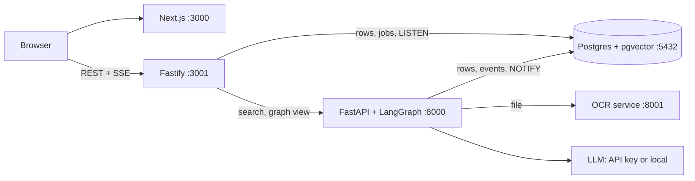
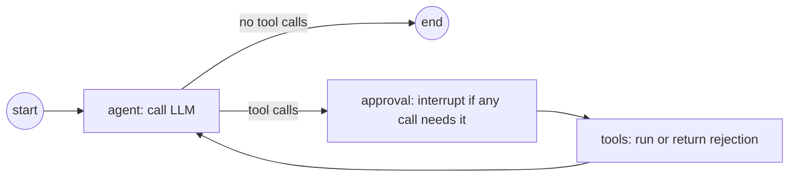

# TaskMaster: local architecture (v0)

Status: proposed, revision 6, for review. No application code exists yet.

Revision 6 runs OCR on 2 pages at a time, which is measured to be 2.3 times faster. Revision 5 moved every component to its latest release as of 2026-11-28, including Postgres 19. It also settles the open decisions: entities are extracted at ingest, and every format except `.txt` and `.md` goes through OCR. Revision 4 removed Redis and Neo4j.

TaskMaster v0 is a single-user AI coworker that runs on one laptop. You create a workspace, add documents of most office formats, and chat with an agent that searches them, follows relationships between the things they mention, writes artifacts, and asks before it changes a file.

Everything is installed and run directly on Windows. Docker is not used.

## System



| Part | Runs | Technology | Job |
| --- | --- | --- | --- |
| `apps/web` | `yarn dev` | Next.js 16.4, React 19.3 | Workspaces, documents, chat, approvals, artifacts, eval results. No business logic. |
| `apps/api` | `yarn dev` | Fastify 5.12, Node 26 LTS | CRUD, uploads, job submission, live events to the browser. The browser's only backend. |
| `services/agent` | `yarn dev`, own venv | FastAPI, LangGraph 1.2, Python 3.14 | Agent graph, tools, ingestion, retrieval. Claims jobs from Postgres. |
| `services/ocr` | `yarn dev`, own venv | FastAPI, LibreOffice 26.8, RapidOCR 3.10, Python 3.14 | Turns a document into page images, then text. Stateless. |
| Postgres | Windows service | Postgres 19, pgvector 0.8.7 | Everything stored: CRUD rows, jobs, run events, vectors, knowledge graph, chat history, agent checkpoints, eval results |
| `evals` | `yarn evals` | Python 3.14 | Runs test cases and stores scores |

Fastify and the agent never hand work to each other over HTTP. Fastify writes a job row, and the agent claims it. Fastify calls the agent's HTTP API only for reads: search and the graph view.

## Local-only access

Every port binds to `127.0.0.1`, which keeps other machines out but not other websites. Any page open in your browser can send requests to `127.0.0.1`, and v0 has no login. So each service also checks who is asking:

| Check | Where | Stops |
| --- | --- | --- |
| The `Host` header must be `localhost:<port>` or `127.0.0.1:<port>` | All four services | DNS rebinding, where a site points its own domain at `127.0.0.1` |
| CORS allows only `http://localhost:3000` | Fastify | Other sites reading responses |
| Every non-GET request must carry the header `X-TaskMaster: 1` | Fastify | Form posts and uploads from other sites: a custom header forces a CORS preflight, which fails for them |
| GET requests never change anything | Fastify | Links and image tags triggering actions |
| Every request must carry `INTERNAL_TOKEN` from `.env` | Agent and OCR service | Anything except Fastify and the agent calling them, including uploads straight to LibreOffice |
| `listen_addresses = 'localhost'`, password login only | Postgres | Other machines and unauthenticated local connections |

## Data

**Postgres.** Fastify owns the schema (`db/schema.sql`). Every table except the eval tables and checkpoints is scoped to a workspace, and every query filters on it.

| Tables | Written by | Notes |
| --- | --- | --- |
| `workspaces`, `threads` | Fastify | Ordinary CRUD |
| `documents` | Both | Fastify creates and deletes; the agent updates `status` (`queued`, `processing`, `ready`, `failed`) |
| `jobs` | Both | Fastify inserts; the agent claims and finishes them. See [Jobs](#jobs). |
| `runs`, `messages` | Both | Fastify records requests, approvals and cancellations; the agent records progress, answers and status. See [Runs](#runs). |
| `run_events` | Agent | Live tokens and steps, numbered per run. Deleted an hour after the run ends. |
| `tool_calls` | Agent | One row per tool call ID with its result, so a repeated call returns the saved result |
| `document_pages` | Agent | Text and OCR confidence per page, so re-chunking never repeats OCR |
| `chunks` | Agent | Text, page number and `vector(384)` with an HNSW cosine index |
| `entities` | Agent | `name` and `kind`; unique per workspace on `kind` and the normalized name |
| `relations` | Agent | Source entity, target entity, `type` and the `chunk_id` it came from |
| `artifacts` | Agent | Fastify lists, renames and deletes them |
| `langgraph.*` | LangGraph | Checkpoints, in their own schema |
| `eval_runs`, `eval_results` | Evals | One row per case per run, tagged with the model used |

**Deleting a document** is one transaction. Pages, chunks and relations reference it with `ON DELETE CASCADE`. Entities left with no relations are removed in the same transaction. The file is then removed from `UPLOAD_DIR`. An ingest job that finds its document gone stops without error.

**Knowledge graph.** `query_graph` runs one fixed, parameterized `WITH RECURSIVE` query that follows relations in both directions for up to 2 hops within a workspace. The model never writes SQL. `relations` is indexed on `(workspace_id, source_entity_id)` and `(workspace_id, target_entity_id)`.

### Jobs

`jobs` has `id`, `kind` (`ingest`, `run`, `resume`), `payload`, `status` (`queued`, `running`, `done`, `failed`), `attempts`, `locked_until` and `last_error`.

- Fastify inserts the row and runs `NOTIFY jobs` in the same transaction as the record it belongs to.
- The agent listens for that notification, and also polls every 5 seconds in case it missed one.
- The agent claims a job with `SELECT ... FOR UPDATE SKIP LOCKED`, sets `locked_until` 60 seconds ahead, and extends it every 20 seconds while it works.
- A job whose lock has expired can be claimed again, so a crashed agent's work resumes when it restarts. After 3 attempts the job is `failed` with its last error.

A job can therefore run twice. Ingestion replaces a document's earlier output, a run continues from its last checkpoint, and tools with side effects are idempotent (see [Agent](#agent)).

### Run events

- The agent appends events to `run_events (run_id, seq, type, data)` and runs `NOTIFY run_events, '<run_id>:<seq>'`.
- Fastify listens on its own connection, outside its pool. It reads the new rows and forwards them as SSE, with `seq` as the event ID.
- A reconnecting browser sends `Last-Event-ID` and receives everything after it. A browser that returns after the events are deleted loads saved messages instead.
- Tokens are batched into one row every 100 ms, not one row per token.

A notification carries only the run and position, not the event, because Postgres limits a notification to 8000 bytes.

### Runs

A run is `queued`, `running`, `awaiting_approval`, `done`, `failed`, `cancelled` or `expired`.

- **Active** means `queued`, `running` or `awaiting_approval`. A thread can have only one active run, so a new message gets a 409 while a run waits for approval.
- **Cancel.** `POST /runs/:id/cancel` sets `cancel_requested_at`. A queued run or one awaiting approval becomes `cancelled` at once. A running run checks the flag before every LLM call and tool call, then stops as `cancelled`. Cancelling a finished run gets a 409.
- **Approval timeout.** A run that waits 24 hours for approval becomes `expired`, and nothing is written. The agent's poll loop applies this.
- **Approving.** `POST /runs/:id/approval {approve}` records the decision and queues a `resume` job. Approval, cancellation and expiry each update the run only `WHERE status = 'awaiting_approval'`, so only the first one wins and the others get a 409.
- **Limits.** A run stops after 15 LLM calls or 10 minutes of running. Time spent waiting for approval does not count.

## How it works

**Adding a document**

1. Fastify saves the file to `UPLOAD_DIR`, records it and queues an `ingest` job.
2. `.txt` and `.md` are read directly. Every other format goes to the OCR service, including PDFs that already contain text, and spreadsheets.
3. The agent saves the pages, splits them into chunks and embeds them locally with `bge-small-en-v1.5` through fastembed.
4. The LLM extracts entities and relations from batches of chunks, each tied to its chunk. The result is checked against a schema and saved to `entities` and `relations`.
5. The document becomes `ready` only after extraction, so every ready document is already in the graph.

**Sending a message**

1. Fastify records a run and queues a `run` job in one transaction. If the thread already has an active run, it returns 409.
2. The agent runs the graph and writes events: `text`, `tool_start`, `tool_end`, `approval_required`, `done`, `cancelled`, `expired`, `error`.
3. Fastify forwards events to the browser as SSE. The run continues if the tab closes.

## OCR service

`POST /extract` takes a file and returns `{pages: [{page, text, confidence}]}`.

| Input | To images | To text |
| --- | --- | --- |
| PDF | pypdfium2 at 200 DPI | RapidOCR |
| DOC, DOCX, XLS, XLSX, PPT, PPTX | LibreOffice to PDF, then as above | RapidOCR |
| PNG, JPG, TIFF | Used as they are | RapidOCR |

RapidOCR runs on CPU through onnxruntime with no key, so documents stay on the laptop during extraction. LibreOffice runs with its own profile, macros disabled, a 25 MB and 200-page limit, and a timeout. Files that exceed a limit are marked `failed` with the reason.

**Pages are OCR'd in parallel:**

- The service keeps 2 worker processes running, each with RapidOCR set to 4 threads.
- The main process turns pages into images one at a time and hands them to the workers. It never holds more than 4 page images at once.
- Results are put back in page order.
- The service handles one document at a time, and LibreOffice converts one file at a time.

| Setup, measured on this laptop | Per page | 200-page document |
| --- | --- | --- |
| 1 process, onnxruntime's default of all 16 threads | 8.4 s | About 28 minutes |
| **2 workers × 4 threads (used)** | **3.6 s** | **About 12 minutes** |
| 4 workers × 2 threads | 3.1 s | About 10 minutes, but up to 2.6 GB of memory |

Every setup produced byte-identical text. The thread count per worker is fixed, so changing the number of workers cannot change the results. More than 4 workers, or more than 4 threads each, was slower: the CPU has 6 performance cores and 10 efficiency cores. Memory, not CPU, is what limits this to 2 workers.

**Without Docker, LibreOffice opens files with your own Windows permissions.** Upload only documents you would open yourself.

**Spreadsheets lose the most.** OCR sees only what prints: formulas and hidden sheets are lost, and wide sheets split across pages. The service sets each sheet to landscape and one page wide before converting.

## Agent

A LangGraph `StateGraph` with three nodes, checkpointed to Postgres:



Approval is its own node because LangGraph reruns an interrupted node from the top. Nothing with a side effect may come before the pause. A pending approval survives a restart and expires after 24 hours.

| Tool | Does | Approval |
| --- | --- | --- |
| `search_documents` | Vector search, top 5 chunks with page numbers | No |
| `query_graph` | Relations within 2 hops of an entity, with source chunks | No |
| `read_document` | One document's text, by page range | No |
| `save_artifact` | Saves a draft inside TaskMaster | No |
| `write_file` | Writes to one configured folder; paths outside it are rejected | **Yes** |

Document text is treated as data, never as instructions. The approval check is in code, so nothing in a document can skip it.

**Side effects are idempotent.** If the agent crashes after a tool runs but before the checkpoint is saved, the tools node runs again.

- Before running a call, the tools node looks up its tool call ID in `tool_calls`. If a result is already saved, it returns that result instead of running the tool.
- `write_file` writes a temporary file in the target folder, then renames it over the target. A repeat produces the same file. It never appends.
- `save_artifact` inserts or updates by tool call ID.

On Windows, the agent must run on a selector event loop, because the Postgres checkpointer rejects the Windows default. It was tested with `uvicorn --loop` on Python 3.12. Python 3.14 deprecates asyncio's event loop policies, so pass the selector loop to uvicorn as a loop factory rather than setting a policy, and test it again on 3.14.

## Rendering model output

Chat messages and artifacts can contain text copied from documents, so the web app treats them as untrusted:

- They are rendered as Markdown with raw HTML removed.
- Remote images are never loaded; they appear as their link text. Loading one would send its URL, and anything injected text put in it, to another server.
- Links show their full URL and open only when clicked, with `rel="noopener noreferrer"`.
- Next.js sends a Content Security Policy with `img-src 'self' data:`, `connect-src` limited to Fastify and `frame-src 'none'`. A bug in the renderer still cannot load a remote resource.
- Fastify serves artifact content as `text/plain` or as a download, with `X-Content-Type-Options: nosniff`, never as HTML.

## Models

One OpenAI-compatible client (`langchain-openai`) covers both hosted and local models. Changing between them changes only `.env`:

| Setting | API key | Local |
| --- | --- | --- |
| `LLM_BASE_URL` | The provider's OpenAI-compatible endpoint | `http://localhost:11434/v1` (Ollama) |
| `LLM_API_KEY` | Your key | Any placeholder |
| `LLM_MODEL` | Provider's model name | For example `qwen3.5:4b` or `qwen3.5:9b` |

- The model must support tool calling and JSON output. Run the evals before relying on a new one.
- Chat, extraction and eval judging all use these settings. `JUDGE_MODEL`, `JUDGE_BASE_URL` and `JUDGE_API_KEY` can point judging elsewhere, since small local models judge poorly.
- With an API key, retrieved document text is sent to that provider. With a local model, nothing leaves the laptop.
- Embeddings always run locally.

## Evals

`yarn evals` uses a separate `taskmaster_eval` Postgres database. Start with about 20 cases and a small fixed set of documents.

| Layer | Checks | Needs an LLM |
| --- | --- | --- |
| OCR | Character accuracy on PDF, DOCX and PPTX; exact cells on XLSX | No |
| Retrieval | Is the right chunk in the top 5? | No |
| Graph | Are the expected relations extracted? | Yes |
| Agent behavior | Right tool used, required facts present, nothing written without approval, injected instructions ignored, no remote resources in output | Yes |
| Answer quality | The judge scores whether the answer is supported by its sources | Yes |

Results are stored by model and shown on an `/evals` page, so hosted and local models can be compared. Every bug found later becomes a new case.

## Repository

```text
apps/web/            Next.js
apps/api/            Fastify
services/agent/      FastAPI + LangGraph
services/ocr/        FastAPI + LibreOffice + RapidOCR
evals/               cases, documents, runner
db/schema.sql        Postgres schema
scripts/doctor.mjs   checks every installation and its version, and prints what is missing
package.json         Yarn 4 workspaces
.env                 LLM, database, INTERNAL_TOKEN and LibreOffice path settings (not committed)
```

The intended commands, once built:

```text
yarn install
py -3.14 -m venv services\agent\.venv
services\agent\.venv\Scripts\pip install -r services\agent\requirements.txt
py -3.14 -m venv services\ocr\.venv
services\ocr\.venv\Scripts\pip install -r services\ocr\requirements.txt
yarn doctor   # checks Postgres 19, pgvector, LibreOffice, Python 3.14 and the model
yarn db:migrate
yarn dev      # web, api, agent and ocr together
yarn evals
```

## Versions

Every component uses its latest stable release, checked on 2026-11-28 with winget, npm and pip. Pre-releases are not used: Fastify 6 and Node 27 are still alpha.

| Component | Version | Notes |
| --- | --- | --- |
| Postgres | 19.0 | Released 2026-11-19. Not yet in winget, which still offers 18.7. |
| pgvector | 0.8.7 | Builds on Postgres 19 according to one Linux CI report; not yet built on Windows |
| Node | 26.13.1 LTS | |
| Yarn | 4.19.0 | |
| Next.js / React | 16.4.6 / 19.3.1 | |
| Fastify / `pg` | 5.12.8 / 8.23.1 | |
| Python | 3.14.10 | **Not 3.15.** onnxruntime 1.32.0, which RapidOCR and fastembed need, has no Python 3.15 wheels. |
| LangGraph / checkpoint-postgres | 1.2.24 / 3.2.1 | |
| langchain-openai | 1.8.5 | |
| FastAPI / uvicorn | 0.165.0 / 0.55.0 | |
| psycopg | 3.3.9 | |
| RapidOCR / onnxruntime | 3.10.0 / 1.32.0 | |
| fastembed | 0.9.1 | Runs `bge-small-en-v1.5` |
| pypdfium2 | 5.15.2 | |
| LibreOffice | 26.8.3 | The "Fresh" line; 26.2 support ends 2026-11-30 |
| Ollama | 0.40.19 | Optional |
| Visual Studio 2026 | 18.11.3 | Already installed; provides the C++ tools for pgvector |

- Dependency files use ranges with these versions as the minimum, for example `^16.4.6` and `>=1.2.24,<2`. That way patch releases arrive on their own.
- Yarn 4.19 refuses packages published in the last 24 hours, and that protection stays on.
- `yarn doctor` fails if an installed component is older than this table.
- Move to Python 3.15 once onnxruntime publishes `cp315` wheels.

## Installing the services

| Service | Install | Starts |
| --- | --- | --- |
| Postgres 19 | EDB installer from postgresql.org/download/windows, until winget offers `PostgreSQL.PostgreSQL.19` | Automatically |
| pgvector 0.8.7 | Build from source, below | With Postgres |
| Python 3.14 | `winget install -e --id Python.Python.3.14` | Used by the agent, OCR service and evals |
| LibreOffice | `winget install -e --id TheDocumentFoundation.LibreOffice` | Called by the OCR service |
| Ollama (optional) | `winget install -e --id Ollama.Ollama` | Only for a local model |

Node 26.13.1 and Yarn 4.19.0 are already installed.

After installing Postgres, set `listen_addresses = 'localhost'` in `C:\Program Files\PostgreSQL\19\data\postgresql.conf`. Allow only `scram-sha-256` logins from `127.0.0.1/32` and `::1/128` in `pg_hba.conf`. Then restart the service.

**pgvector** has no official Windows installer. Open "x64 Native Tools Command Prompt for VS" **as administrator** and follow its official instructions.

```text
set "PGROOT=C:\Program Files\PostgreSQL\19"
cd %TEMP%
git clone --branch v0.8.7 https://github.com/pgvector/pgvector.git
cd pgvector
nmake /F Makefile.win
nmake /F Makefile.win install
```

## Memory

Checked on 2026-11-28: the laptop has 15.2 GB, of which 1.5 GB was free. 27.4 GB was committed, so Windows was already using the page file. The largest users were Claude (2.7 GB), VS Code (2.6 GB), Chrome (2.6 GB) and ChatGPT (0.6 GB).

TaskMaster's estimated needs, not measured:

| Part | Estimate |
| --- | --- |
| Postgres | 0.2 to 0.3 GB |
| Fastify | About 0.1 GB |
| Next.js dev server | 0.5 to 1 GB |
| Agent, with the embedding model | 0.3 to 0.8 GB |
| OCR service, 2 workers | About 0.4 GB idle; up to 1.4 GB during OCR (measured: one worker peaks at 648 MB and idles at 162 MB) |
| LibreOffice, while converting | 0.2 to 0.4 GB more |
| **Total** | **About 1.5 to 2.5 GB idle; 2.5 to 4 GB while a document is being OCR'd** |

That is more than was free on 2026-11-28 (1.5 GB). Close ChatGPT and some Chrome tabs while developing, or the system will page. If memory is still short, set `OCR_WORKERS=1`: OCR becomes slower, but the text stays the same.

A local model needs about its download size plus 2 GB: `qwen3.5:4b` is about 3.4 GB and `qwen3.5:9b` about 6.6 GB. Use an API key day to day, and a local model with other applications closed, or on another machine through `LLM_BASE_URL`.

## What was tested

On the target Windows 11 laptop on 2026-11-23, using throwaway scripts. The Python tests used 3.12, before the move to 3.14.

| Assumption | Result |
| --- | --- |
| LangGraph pauses for approval, then resumes from Postgres in a new process | Works with a selector event loop; **fails** with the Windows default |
| `uvicorn --loop` can supply that event loop | Works on Python 3.12; not tested on 3.14 |
| OpenAI-compatible client with a custom URL, streaming and tool calls | Works against a stub server, not a real model |
| OCR on two synthetic scanned A4 pages at 200 DPI (slight skew, blur and noise) | All text and 92 of 92 table cells correct; 5 to 7 s per page on CPU. Real scans will score lower. |
| Parallel OCR on 8 synthetic, text-dense A4 pages at 200 DPI (2026-11-29, Python 3.12, onnxruntime 1.32.0) | 8.4 s per page with 1 process at default threads; 3.6 s with 2 workers × 4 threads; byte-identical text in all 8 setups tried |
| Vector search with pgvector 0.8.7 and local embeddings | Works on Postgres 16; Postgres 19 not tested |
| Node 26.13.1, npm 11.20.0, Yarn 4.19.0, corepack 0.36.0 | Work |
| Yarn installs Next.js 16.4.6, React 19.3.1, Fastify 5.12.8 and `pg` 8.23.1 | Works, with install scripts off; no app was built or run |
| Visual Studio C++ tools needed for pgvector | Present (18.11.3) |
| onnxruntime wheels for Python 3.15 | **None published** (checked 2026-11-28) |
| Building pgvector; running Postgres 19 and LibreOffice natively | **Not tested** |
| Postgres job queue with `SKIP LOCKED`, `LISTEN`/`NOTIFY` events, recursive graph query | **Not tested** |
| A real hosted or local model | **Not tested** |

## Left out of v0

| Left out | Add it when |
| --- | --- |
| Login and multiple users | Anyone else uses it, or it leaves the laptop |
| Web search, Google and GitHub connectors | The core loop passes its evals |
| Code execution | There is a sandbox to run it in |
| Multiple agents | One graph with these tools fails cases it should pass |
| Separate queue (Redis) | Polling Postgres becomes measurably slow |
| Separate graph database (Neo4j) | Recursive graph queries become measurably slow |
| Separate vector database | pgvector search becomes measurably slow |

## Before building

1. **Install the services** in the table above. Most need administrator rights.
2. **Choose a model**: an API key and provider, or Ollama.
3. **Move the repository out of OneDrive.**
